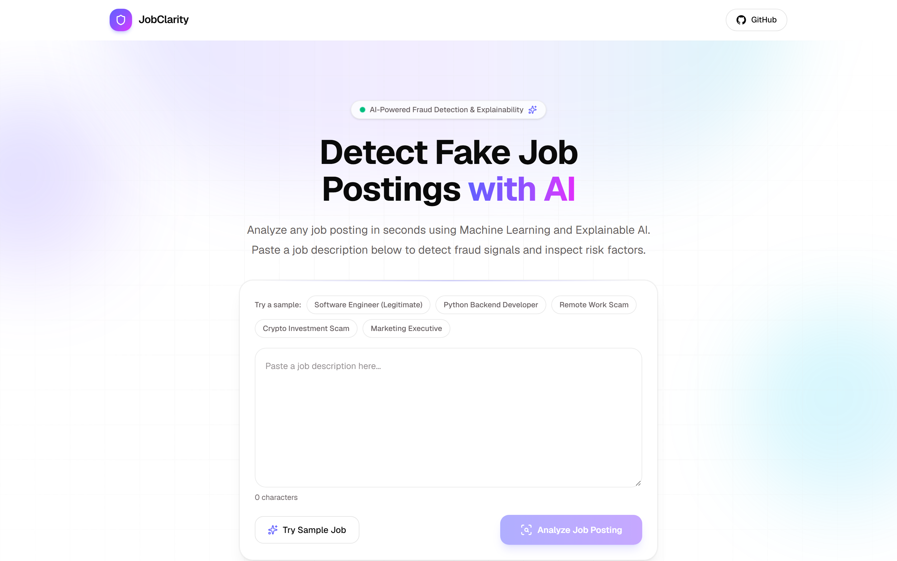

<div align="center">

# JobClarity Frontend

**Production-grade, Explainable AI interface for detecting fraudulent job postings using Machine Learning and Native TreeSHAP feature attributions.**

[](https://jobclarity.vercel.app/)
[](https://github.com/divysaxena24/JobClarity)
[](LICENSE)

<br />


</div>

---

## Table of Contents

- [1. Project Overview](#1-project-overview)
- [2. Key Features](#2-key-features)
- [3. Application Screenshots](#3-application-screenshots)
- [4. Technology Stack](#4-technology-stack)
- [5. Architecture & Data Flow](#5-architecture--data-flow)
- [6. Project Folder Structure](#6-project-folder-structure)
- [7. Prerequisites & Installation](#7-prerequisites--installation)
- [8. Environment Variables](#8-environment-variables)
- [9. Local Development Instructions](#9-local-development-instructions)
- [10. Backend API Integration](#10-backend-api-integration)
- [11. Production Deployment (Vercel)](#11-production-deployment-vercel)
- [12. Available Scripts](#12-available-scripts)
- [13. Error Handling & Loading States](#13-error-handling--loading-states)
- [14. Limitations & Responsible-Use Disclaimer](#14-limitations--responsible-use-disclaimer)

---

## 1. Project Overview

**JobClarity** is an open-source, Explainable AI (XAI) platform engineered to protect job seekers from recruitment fraud, identity phishing, upfront-fee scams, and deceptive employment listings.

While conventional threat detection tools operate as opaque "black boxes," JobClarity pairs machine learning risk classification with **transparent, feature-level mathematical explanations**. Users can analyze any job posting in seconds, receive calibrated fraud probabilities and risk scores, and interactively inspect which specific words and phrases increased or decreased the model's suspicion.

This repository hosts the **production frontend**, built with the **Next.js App Router**, **React 19**, **TypeScript**, and **Tailwind CSS**. It communicates with the independent [JobClarity FastAPI Backend](https://github.com/divysaxena24/JobClarity) deployed on Render.

---

## 2. Key Features

### 🔍 Real-Time Job Description Analysis
- **Flexible Input**: Paste raw job descriptions of any length (validated with client-side character counters; backend accepts up to 50,000 characters).
- **One-Click Sample Postings**: Instant demo chips featuring authentic software engineering roles alongside real-world scam templates (unrealistic salary guarantees, wire transfers, crypto recruitment).

### 📊 Calibrated Probability & Risk Score
- **Fraud Probability**: Continuous statistical probability displayed with sub-decimal precision (`0.0% – 100.0%`).
- **Fraud Risk Score (0–100)**: Integer severity metric mapped directly to color-coded operational risk tiers:
  - `0 – 25`: **Low Risk** (Standard professional vocabulary and typical responsibilities).
  - `26 – 50`: **Medium Risk** (Elevated linguistic anomalies; caution advised).
  - `51 – 75`: **High Risk** (Significant deceptive signals and scam markers detected).
  - `76 – 100`: **Critical Risk** (Immediate caution; high concentration of fraud patterns).
- **Animated SVG Radial Gauge**: Smooth CSS/Framer Motion gauge visualizing risk severity with accessible color contrast.

### 🧠 Interactive SHAP Explainability Dashboard
- **Native TreeSHAP Attributions**: Powered by XGBoost TreeSHAP contributions returned directly from the backend.
- **Bi-Directional Recharts Visualization**:
  - 🔴 **Red (+)**: Features that **increase** fraud risk (e.g. `wire`, `urgently`, `telegram`, `check`).
  - 🟢 **Emerald (-)**: Features that **decrease** fraud risk (e.g. `experience`, `developer`, `benefits`, `team`).
- **Dynamic Controls**: Sort by absolute impact or model direction; filter across Top 5, Top 10, or all detected features.
- **Interactive Inspection**: Clicking any bar surfaces an expanded detail card with rank, absolute attribution magnitude, and feature role.

### 📝 Job Description Explorer (In-Context Highlighting)
- **Inline Text Highlighting**: Renders the complete analyzed job description with highlighted tokens matching influential model features.
- **Bidirectional Linking**: Selecting a feature in the chart or list automatically scrolls to and illuminates matching keywords within the posting text.
- **Safe ReDoS-Proof Matching**: Built with regex boundary validation and sanitization (`escapeRegExp`) to render highlights without DOM injection.

### 📄 Client-Side PDF Report Export
- **One-Click Enterprise Report**: Downloadable, publication-quality A4 PDF compiled 100% in the browser using `jspdf` (zero external network transmission).
- **Complete Audit Trail**: Includes JobClarity branding, generation timestamp, unique analysis identifier, overall verdict, risk tier badge, model version (`1.0.0`), top SHAP feature breakdown table, and full multi-page original job posting text.
- **Automated Pagination**: Dynamic line budgeting prevents content clipping, text overlap, or orphaned footers across multi-page descriptions.

---

## 3. Application Screenshots

### Hero Section & Job Description Input
Clean SaaS interface with sample job quick-select chips, manual paste workflow, and interactive analyze trigger.



### Risk Assessment & Prediction Dashboard
Instant classification with animated 0–100 risk gauge, calibrated probability metric, moderation actions, and categorical risk tier indicators.

```
+-----------------------------------------------------------------------------+
|                                                                             |
|  [ CRITICAL RISK ]  Score: 94/100  |  Probability: 94.2%  |  Action: BLOCK  |
|                                                                             |
|  Reasoning: Significant deceptive signals, vocabulary anomalies, or scam    |
|  patterns detected. Telegram recruitment channels & registration fee flags. |
|                                                                             |
+-----------------------------------------------------------------------------+
```
*(High-risk detection view highlighting critical fraud signals and automated moderation recommendation)*

### Interactive SHAP Feature Contribution Chart
Bidirectional Recharts bar visualization displaying top-K risk factors with exact TreeSHAP attribution values and risk-increasing vs risk-decreasing color coding.

```
+-----------------------------------------------------------------------------+
|  Top Feature Contributions (TreeSHAP Margin Impact)                         |
|                                                                             |
|  [+1.85] registration fee   ====================================> (Red)     |
|  [+1.42] telegram           =============================> (Red)            |
|  [+1.28] guaranteed returns =========================> (Red)                |
|  [-0.62] competitive salary <============ (Green)                          |
|  [-0.81] engineering        <================ (Green)                      |
+-----------------------------------------------------------------------------+
```
*(Interactive explainability chart with feature sorting, filtering, and tooltip breakdown)*

### Job Description Intelligence Explorer & In-Context Highlighting
Full job text with interactive phrase highlights mapped directly to SHAP attribution signals and feature detail drawer.

```
+-----------------------------------------------------------------------------+
|                                                                             |
|  URGENT!! Work from home data entry job. Earn Rs. 50,000 per week with NO   |
|  experience needed. Just pay a [one-time registration fee] of Rs. 2,000 to  |
|  unlock unlimited tasks. Contact immediately on [Telegram]...               |
|                                                                             |
+-----------------------------------------------------------------------------+
```
*(Contextual token inspector highlighting deceptive phrasing directly inside the original posting)*

---

## 4. Technology Stack

This repository uses strictly the technologies declared in [`package.json`](package.json):

| Category | Technology | Version | Purpose in JobClarity |
| :--- | :--- | :---: | :--- |
| **Framework** | [Next.js](https://nextjs.org/) | `16.2.12` | React framework with App Router, server layouts, and static optimization. |
| **UI Library** | [React](https://react.dev/) | `19.2.4` | Modern component architecture, hooks, and transitions. |
| **Language** | [TypeScript](https://www.typescriptlang.org/) | `5.x` | Strict type safety across UI props, API schemas, and PDF generators. |
| **Styling** | [Tailwind CSS](https://tailwindcss.com/) | `4.x` | Utility-first styling with modern CSS variables and color palettes. |
| **Animations** | [Framer Motion](https://www.framer.com/motion/) | `12.43.0` | Accessible entry/exit animations, gauge transitions, and skeleton loaders. |
| **Data Viz** | [Recharts](https://recharts.org/) | `3.10.1` | Responsive SVG bi-directional bar charts for SHAP attributions. |
| **PDF Export** | [jsPDF](https://github.com/parallax/jsPDF) | `4.2.1` | Client-side, zero-dependency PDF document generation. |
| **Icons** | [Lucide React](https://lucide.dev/) | `1.28.0` | Clean, lightweight SVG iconography. |
| **HTTP Client**| [Axios](https://axios-http.com/) | `1.19.0` | Typed REST requests, cold-start timeouts, and structured error parsing. |
| **Utility** | `clsx` & `tailwind-merge` | `2.x / 3.x` | Safe conditional class merging via `cn()`. |

---

## 5. Architecture & Data Flow

```
+-----------------------------------------------------------------------------+
|                               CLIENT BROWSER                                |
|                                                                             |
|   +-----------------------+              +------------------------------+   |
|   |   Job Description     |              |   Interactive SHAP Chart     |   |
|   |   Textarea & Samples  |              |   & In-Context Highlighting  |   |
|   +-----------+-----------+              +--------------^---------------+   |
|               |                                         |                   |
|               v                                         |                   |
|   +-----------------------+              +--------------+---------------+   |
|   |  lib/api/client.ts    |              |  Prediction Dashboard &      |   |
|   |  (Typed Axios Client) |              |  PDF Report Generator (jsPDF)|   |
|   +-----------+-----------+              +--------------^---------------+   |
+---------------|-----------------------------------------|-------------------+
                |                                         |
         POST /predict (JSON)                      HTTP 200 OK
   {"job_description": "..."}               {prediction, probability,
                |                           score, risk_level, top_reasons}
                v                                         |
+---------------------------------------------------------|-------------------+
|                           BACKEND API (Render)                              |
|                                                                             |
|   +-----------------------------------------------------+---------------+   |
|   |  FastAPI Router -> Pydantic Schema Validation (20 - 50,000 chars)   |   |
|   |  Rate Limiting (60 req/min per IP) -> Text Cleaning -> TF-IDF Matrix|   |
|   |  XGBoost Booster Inference -> Native TreeSHAP Explanation Engine    |   |
|   +---------------------------------------------------------------------+   |
+-----------------------------------------------------------------------------+
```

### Request Flow Lifecycle:
1. **Input Submission**: The user pastes a job description or selects a sample chip in `AnalyzerCard.tsx`.
2. **Client Validation**: The UI ensures text length meets the minimum 20-character threshold.
3. **API Dispatch**: `predictJob()` in `lib/api/client.ts` issues a `POST` request to `/predict`. A 60-second timeout accommodates potential free-tier cloud cold starts.
4. **Backend Processing**: FastAPI validates the payload, verifies rate limits (60 req/min), transforms text via a 5,000-feature TF-IDF matrix, executes XGBoost prediction, and computes exact feature contributions using native C++ TreeSHAP.
5. **UI Rendering**: `PredictionDashboard.tsx` hydrates `PredictionSummary.tsx` (gauge and metrics), `SHAPChart.tsx` (bi-directional bar chart), and `JobDescriptionExplorer.tsx` (interactive text highlights).
6. **Local Export**: If requested, `reportGenerator.ts` compiles a vector PDF directly in browser memory and triggers an instant client download.

---

## 6. Project Folder Structure

```
jobclarity-frontend/
├── app/
│   ├── favicon.ico                   # Application favicon
│   ├── globals.css                   # Global Tailwind CSS definitions & design tokens
│   ├── layout.tsx                    # Root layout, HTML metadata & font definitions
│   └── page.tsx                      # Single-page application entry point
├── components/
│   ├── analyzer/
│   │   ├── AnalyzerCard.tsx          # Textarea input, char counter, and submit controls
│   │   └── SampleJobs.tsx            # Curated legitimate and fraudulent job templates
│   ├── layout/
│   │   ├── Features.tsx              # Educational overview of platform capabilities
│   │   ├── Footer.tsx                # Footer with repo links and disclaimers
│   │   ├── Hero.tsx                  # Main interactive container coordinating state
│   │   ├── HeroBackground.tsx        # Subtle SVG gradient backdrop
│   │   └── Navbar.tsx                # Navigation header and external repository links
│   ├── prediction/
│   │   ├── AnimatedRiskGauge.tsx     # SVG radial gauge with dynamic color interpolation
│   │   ├── ConfidenceRing.tsx        # Circular statistical probability indicator
│   │   ├── EmptyState.tsx            # Pre-analysis guidance and quick-start tips
│   │   ├── FeatureImpactCard.tsx     # Compact feature attribution card
│   │   ├── InfoTooltip.tsx           # Accessible tooltips explaining metrics
│   │   ├── JobDescriptionExplorer.tsx# Full posting view with SHAP phrase highlighting
│   │   ├── LoadingState.tsx          # Skeleton loader with stage-by-stage pipeline status
│   │   ├── PredictionDashboard.tsx   # Results layout housing summary, charts & explorer
│   │   ├── PredictionSummary.tsx     # Verdict banner, risk score, and PDF export trigger
│   │   ├── ProbabilityBar.tsx        # Linear probability progress meter
│   │   ├── ReasonList.tsx            # Filterable list of contributing SHAP features
│   │   ├── RiskBadge.tsx             # Color-coded badge (Low, Medium, High, Critical)
│   │   ├── RiskGuide.tsx             # Collapsible reference guide for risk levels
│   │   ├── RiskMeter.tsx             # Segmented risk severity meter
│   │   ├── SHAPChart.tsx             # Recharts horizontal bi-directional attribution chart
│   │   └── SHAPFeatureDetailCard.tsx # Detailed view of individual feature impacts
│   └── ui/                           # Primitive UI components (Button, Card, Badge, Alert)
├── lib/
│   ├── api/
│   │   └── client.ts                 # Typed Axios instance, cold-start & error parsers
│   ├── pdf/
│   │   └── reportGenerator.ts        # Client-side multi-page A4 PDF export engine (jsPDF)
│   └── utils.ts                      # `cn()` utility combining clsx and tailwind-merge
├── public/                           # Static SVG assets and icons
├── types/
│   └── prediction.ts                 # TypeScript interfaces for request/response schemas
├── components.json                   # Component registry configuration
├── eslint.config.mjs                 # ESLint flat configuration
├── next.config.ts                    # Next.js configuration
├── package.json                      # Scripts and pinned dependencies
├── postcss.config.mjs                # PostCSS configuration for Tailwind
└── tsconfig.json                     # Strict TypeScript compiler configuration
```

---

## 7. Prerequisites & Installation

### Prerequisites
- **Node.js**: `v20.x` or `v22.x` (LTS recommended)
- **Package Manager**: `npm` (bundled with Node) or `pnpm`

### Installation Steps

1. **Clone the repository:**
   ```bash
   git clone https://github.com/divysaxena24/JobClarity-frontend.git
   cd JobClarity-frontend
   ```

2. **Install project dependencies:**
   ```bash
   npm install
   ```

---

## 8. Environment Variables

The frontend relies on a single public environment variable to locate the JobClarity prediction API.

Create a `.env.local` file in the project root:

```bash
# ==============================================================================
# JobClarity Frontend Environment Configuration
# ==============================================================================

# URL of the JobClarity FastAPI backend.
# - For local backend development : http://127.0.0.1:8000
# - For production cloud backend  : https://jobclarity-0tz8.onrender.com
NEXT_PUBLIC_API_BASE_URL=https://jobclarity-0tz8.onrender.com
```

### Configuration Notes:
- If `NEXT_PUBLIC_API_BASE_URL` is omitted, the Axios client safely defaults to `http://127.0.0.1:8000` (ideal for local full-stack development).
- Do **not** commit `.env.local` or any file containing private keys to version control (`.gitignore` excludes all `.env*.local` files).

---

## 9. Local Development Instructions

### Running with a Remote Backend
If you want to run the frontend locally while connecting to the deployed cloud API:

```bash
# Set environment variable inline or in .env.local
NEXT_PUBLIC_API_BASE_URL=https://jobclarity-0tz8.onrender.com npm run dev
```

### Running with a Local Backend
If you are developing against the backend repository locally:

1. **Start the backend server** (from the `JobClarity` backend directory):
   ```bash
   uvicorn src.api.main:app --host 127.0.0.1 --port 8000 --reload
   ```

2. **Start the frontend server** (from this directory):
   ```bash
   npm run dev
   ```

3. Open [http://localhost:3000](http://localhost:3000) in your browser.

---

## 10. Backend API Integration

The frontend integrates with the JobClarity FastAPI service via standard REST contracts:

- **Endpoint**: `POST /predict`
- **Request Headers**: `Content-Type: application/json`

### Request Payload
```json
{
  "job_description": "Senior Software Engineer needed at Acme Corp. 5+ years React/Node experience. Competitive salary, remote options, health benefits."
}
```

### Response Schema (`PredictionResponse`)
```json
{
  "prediction": "Real",
  "fraud_probability": 0.0823,
  "fraud_risk_score": 8,
  "risk_level": "Low",
  "top_reasons": [
    {
      "feature": "developer",
      "impact": -0.7241,
      "effect": "Decreases fraud risk"
    },
    {
      "feature": "experience",
      "impact": -0.6102,
      "effect": "Decreases fraud risk"
    },
    {
      "feature": "urgently",
      "impact": 0.4125,
      "effect": "Increases fraud risk"
    }
  ],
  "model_version": "1.0.0"
}
```

---

## 11. Production Deployment (Vercel)

The frontend is continuously deployed to **Vercel** with automatic preview branches for pull requests.

### Deploying Your Own Instance on Vercel:

1. Push your fork to GitHub.
2. Log in to [Vercel](https://vercel.com/) and click **Add New Project**.
3. Import your `JobClarity-frontend` repository.
4. In the **Environment Variables** section, configure:
   - `NEXT_PUBLIC_API_BASE_URL`: The URL of your deployed JobClarity backend (e.g. `https://your-api.onrender.com`).
5. Click **Deploy**. Vercel will execute `npm run build` and provision global CDN edge routing.

---

## 12. Available Scripts

Defined in [`package.json`](package.json):

| Command | Action |
| :--- | :--- |
| `npm run dev` | Starts the local development server with Turbopack at `http://localhost:3000`. |
| `npm run build` | Compiles the production build, runs TypeScript validation, and generates static pages. |
| `npm run start` | Serves the optimized production build locally. |
| `npm run lint` | Runs ESLint across all `.ts` and `.tsx` source files to verify code quality. |

---

## 13. Error Handling & Loading States

- **Cloud Cold Starts (`ECONNABORTED`)**: Free-tier cloud instances (such as Render) spin down during periods of inactivity. If a request times out, the client catches the code and presents a clear, actionable banner: *"The server is waking up. Please wait 30–60 seconds and try again."*
- **Validation Errors (HTTP 422)**: When inputs are malformed or shorter than 20 characters, the client extracts the structured Pydantic `detail` messages and displays user-friendly field warnings.
- **Rate Limit Alerts (HTTP 429)**: If the backend rate limit (60 req/min) is exceeded, the user receives an alert displaying the required backoff duration (`Retry-After`).
- **Loading Skeleton**: While the model and SHAP explainers execute, `LoadingState.tsx` displays an animated progress checklist (vectorizing text, calculating probability, extracting SHAP signals).

---

## 14. Limitations & Responsible-Use Disclaimer

JobClarity is designed as an **automated decision-support aid** for job seekers, recruiters, and platform moderators. Please note the following critical boundaries:

1. **Statistical Risk Estimates, Not Proof**:
   All outputs (`fraud_probability`, `fraud_risk_score`, `risk_level`) are statistical estimates produced by machine learning models trained on historical text corpora. A high risk score indicates linguistic correlation with known scam archetypes; **it does not constitute legal proof of criminal intent or fraud**.
2. **Absence of Proof (Corporate Camouflage)**:
   A "Low Risk" classification **does not guarantee that an employer or job posting is authentic or legally verified**. Sophisticated scammers occasionally copy-paste authentic job descriptions verbatim from Fortune 500 companies ("corporate camouflage"), executing scams through off-platform channels (e.g. spoofed email domains, Telegram interviews, fake cashier checks).
3. **Correlation vs. Causation (SHAP Attributions)**:
   SHAP feature values explain how strongly individual words or n-grams pushed the model's mathematical decision boundary for a specific posting. **SHAP values reflect statistical association, not real-world causation**.
4. **Mandatory Due Diligence**:
   Job seekers must always verify employer credentials independently:
   - Confirm recruiter email domains match official company websites.
   - Never wire funds, cash unverified checks, purchase home-office equipment upfront, or disclose banking passwords.

---

<div align="center">

**JobClarity** — *Detect fake jobs. Restore trust in employment.*

[🌐 Live Application](https://jobclarity.vercel.app/) • [⚙️ Backend Repository](https://github.com/divysaxena24/JobClarity)

</div>
